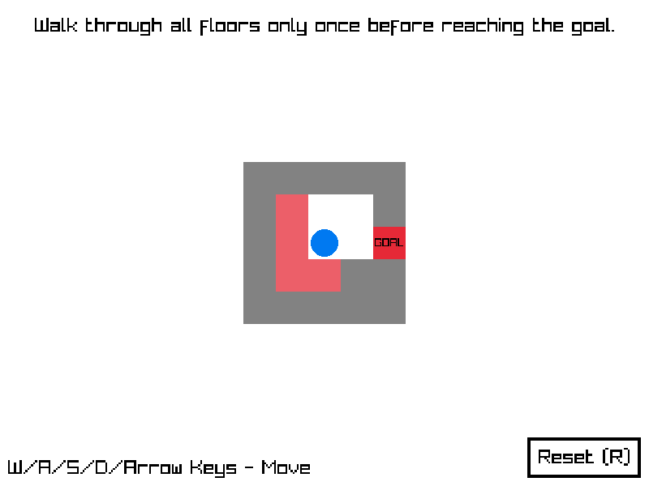

# Hamiltonian Escape
[英語版 (English)](./README.md)

「Hamiltonian Escape」は[ハミルトン路](https://ja.wikipedia.org/wiki/%E3%83%8F%E3%83%9F%E3%83%AB%E3%83%88%E3%83%B3%E8%B7%AF)の概念をベースにしたシンプルな2Dパズルゲームです。 
プレイヤーは各部屋において、ゴール/出口に到達するまでに各セルを最大1回までしか通ることができません。

本ゲームはC++と[Raylib](https://www.raylib.com/)ライブラリを使用して制作しました。
C++のコードをHTML5で動かせるために[emscripten](https://emscripten.org/)を使用しました。 
また、BGMを作成するには[PixiTracker](https://warmplace.ru/soft/pixitracker/)を使用しました。

2022年1月25日〜2022年1月30日に開催された「No Going Back（後戻りはできない）」というテーマの[「JameGam15」ゲームジャム](https://itch.io/jam/jame-gam-15)への提出作品として制作されました。

ゲームは[こちら](https://jayzonty.itch.io/hamiltonian-escape)からブラウザ上でプレイできます。
